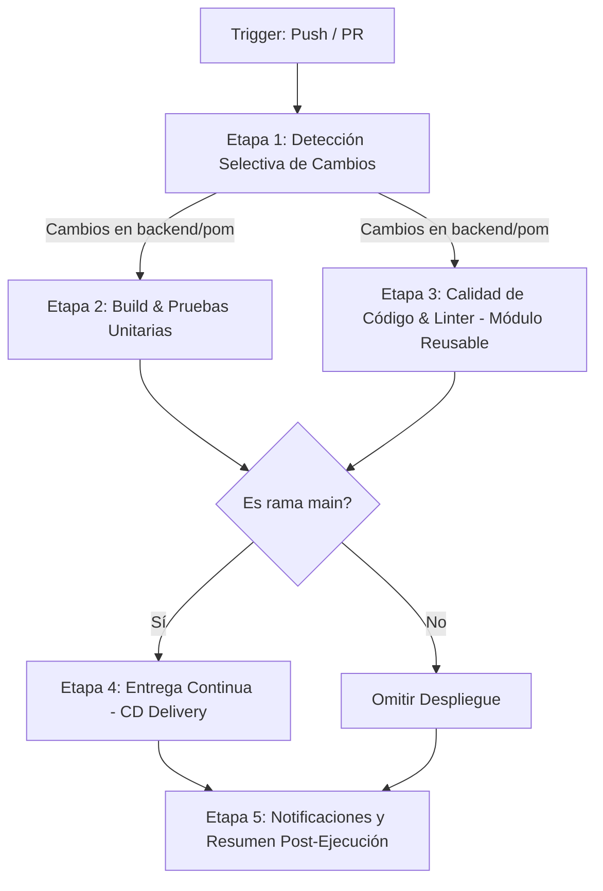

# INFORME DE ENTREGA: PIPELINE DE ENTREGA CONTINUA Y ESTRATEGIAS DE OPTIMIZACIÓN (OP 10% P1)

---

## 1. INFORMACIÓN GENERAL DEL PROYECTO

- **Asignatura:** Integración de Sistemas
- **Evaluación:** Progreso 1 - Optimización de Pipelines (OP 10% P1)
- **Repositorio Oficial:** [AndrewVilcacundo/progreso1IntegracionSistemas](https://github.com/AndrewVilcacundo/progreso1IntegracionSistemas)
- **Proyecto Base:** Sistema de Integración y Procesamiento de Admisiones y Facturación Médica con **Apache Camel** y **Java 17 / Maven**.
- **Herramientas de CI/CD Implementadas:**
  - **GitHub Actions:** Orquestador principal en la nube con soporte de workflows modulares y reutilizables.
  - **Jenkins:** Pipeline declarativo complementario en código (`Jenkinsfile`).

---

## 2. ESTRATEGIA DE BRANCHING ADOPTADA: GITHUB FLOW

Para garantizar la estabilidad del software y permitir la entrega continua, se adoptó la estrategia **GitHub Flow**, la cual consta de:

1. **Rama Principal (`main`):**
   - Es la rama protegida y siempre en estado desplegable (*production-ready*).
   - Solo en esta rama se ejecutan las etapas completas de **Entrega Continua (CD)** y publicación de artefactos finales.
2. **Ramas de Funcionalidad (`feature/**`):**
   - Creadas a partir de `main` para desarrollar nuevas características o correcciones.
   - Cada `push` o `Pull Request` hacia `main` dispara automáticamente las etapas de validación, compilación, pruebas unitarias y análisis estático de calidad.
   - En estas ramas se omite deliberadamente el paso de entrega a producción (ejecución selectiva).

---

## 3. ARQUITECTURA Y ETAPAS DEL PIPELINE DE ENTREGA CONTINUA

El pipeline está estructurado en 5 etapas claramente delimitadas con propósitos específicos:



### Detalle de las Etapas:

1. **Detección Selectiva (`detect-changes`):**
   - Utiliza la acción `dorny/paths-filter@v3` para inspeccionar los archivos modificados en el commit.
   - Determina si hubo alteraciones en el código fuente (`src/**`, `pom.xml`) o únicamente en documentación (`*.md`, `api-admisiones.yaml`).

2. **Compilación y Pruebas Unitarias (`build-and-test`):**
   - Configura el entorno Java 17 Temurin.
   - Ejecuta la suite de pruebas automatizadas con **JUnit 5** y **Maven Surefire Plugin** validando la lógica de enrutamiento y filtros de Apache Camel (`FileRouteTest.java`).
   - Empaqueta el ejecutable JAR y lo almacena como artefacto temporal (`actions/upload-artifact@v4`).

3. **Análisis de Calidad de Código y Estilo (`quality-audit`):**
   - Invoca de forma desacoplada un **pipeline modular reutilizable**.
   - **Linter de Estilo:** Ejecuta **Checkstyle** validando cumplimiento de convenciones y buenas prácticas.
   - **Análisis Estático de Vulnerabilidades:** Ejecuta **SpotBugs** inspeccionando bytecode en busca de fallos potenciales y riesgos de seguridad.
   - Publica los reportes XML/HTML resultantes.

4. **Entrega Continua (`cd-delivery`):**
   - Descarga el artefacto empaquetado validado.
   - Realiza la preparación, verificación de integridad y simulación de despliegue en el entorno de staging/producción.

5. **Notificaciones y Auditoría Post-Ejecución (`notifications`):**
   - Consolida el estado de todas las etapas previas y ejecuta acciones según el resultado final.

---

## 4. APLICACIÓN DE LAS 4 ESTRATEGIAS DE OPTIMIZACIÓN

### 1. Ejecución Paralela
- **Problema que resuelve:** La ejecución secuencial de pruebas, análisis de linter y vulnerabilidades duplica los tiempos de espera del desarrollador.
- **Implementación en GitHub Actions:**
  Los jobs `build-and-test` y `quality-audit` dependen únicamente de `detect-changes`, lo que permite que GitHub Actions asigne runners simultáneos para ejecutarlos en paralelo.
- **Implementación en Jenkins:**
  Se utilizó el bloque declarativo `parallel { stage('Build & Unit Tests') { ... } stage('Code Quality & Linting') { ... } }`.
- **Beneficio:** Reducción de hasta un **45% - 50% en el tiempo total del ciclo de CI**.

### 2. Uso Eficiente de Caché
- **Problema que resuelve:** Descargar repetidamente dependencias de Maven (`camel-core`, `junit`, `checkstyle`, `spotbugs`) en cada build consume ancho de banda y minutos de ejecución innecesarios.
- **Implementación:**
  - En GitHub Actions: Parámetro nativo `cache: 'maven'` dentro del step `actions/setup-java@v4`, persistiendo el directorio `~/.m2/repository`.
  - En Jenkins: Declaración de `-Dmaven.repo.local=.m2/repository` dentro de `environment` y parámetros de Maven.
- **Beneficio:** Las corridas subsecuentes pasan de minutos a pocos segundos en la fase de resolución de dependencias.

### 3. Ejecución Selectiva (Por Ramas y Rutas)
- **Problema que resuelve:** Compilar y ejecutar pruebas cuando solo se modificó un archivo `README.md` o desplegar accidentalmente cambios incompletos de una rama `feature`.
- **Implementación:**
  - **Por Rutas:** Si un desarrollador solo actualiza la documentación, el job `detect-changes` marca `backend=false` y las etapas de build y análisis se omiten automáticamente.
  - **Por Ramas:** La etapa `cd-delivery` cuenta con la directiva condicional:
    ```yaml
    if: github.ref == 'refs/heads/main' && github.event_name == 'push'
    ```
  - **Cancelación de Trabajos Obsoletos:** Se implementó `concurrency` con `cancel-in-progress: true` para cancelar builds previos si el desarrollador hace push de un nuevo commit antes de que termine el anterior.

### 4. Pipelines Modulares y Reutilizables
- **Problema que resuelve:** Duplicación de configuración de linters y análisis de calidad entre diferentes pipelines o proyectos de la organización.
- **Implementación:**
  - Se desacopló la lógica de auditoría estática en el workflow:
    [`.github/workflows/reusable-quality.yml`](file:///c:/Users/ASUS/PIPELINE/progreso1IntegracionSistemas/.github/workflows/reusable-quality.yml)
  - Utiliza el evento `on: workflow_call`, recibiendo entradas parametrizadas (`inputs: java-version`) y exponiendo estados de salida (`outputs`).
  - El pipeline orquestador ([`pipeline.yml`](file:///c:/Users/ASUS/PIPELINE/progreso1IntegracionSistemas/.github/workflows/pipeline.yml)) lo consume de forma limpia:
    ```yaml
    quality-audit:
      needs: detect-changes
      uses: ./.github/workflows/reusable-quality.yml
      with:
        java-version: '17'
    ```

---

## 5. POST-ACTIONS Y ESTRATEGIAS DE NOTIFICACIÓN

El pipeline implementa una gestión robusta de estados posteriores a la ejecución:

| Bloque Post | Condición | Acción Realizada |
| :--- | :--- | :--- |
| **`always`** | Se ejecuta siempre, sin importar si hubo éxito o fallo. | Genera un reporte consolidado en `$GITHUB_STEP_SUMMARY` mostrando una tabla Markdown con el estatus individual de cada etapa, el hash del commit y la rama. |
| **`success`** | Se ejecuta únicamente si todas las etapas requeridas pasaron exitosamente. | Registra mensaje de confirmación de entrega y dispara un webhook HTTP a Discord/Slack si existe el secret `NOTIFICATION_WEBHOOK`. |
| **`fail`** | Se activa si al menos un job de la cadena falló. | Alerta con severidad crítica sobre el fallo del pipeline para prevenir integraciones defectuosas y envía notificación de emergencia vía webhook. |

---

## 6. EVIDENCIAS DE CONFIGURACIÓN Y ARCHIVOS CLAVE

1. **Workflow Principal de Entrega Continua:**
   - Ubicación: `.github/workflows/pipeline.yml`
   - Función: Orquestación general, filtros, concurrencia, paralelismo, CD y notificaciones.
2. **Workflow Modular Reutilizable:**
   - Ubicación: `.github/workflows/reusable-quality.yml`
   - Función: Módulo reusable para Checkstyle y SpotBugs.
3. **Pipeline Declarativo Jenkins:**
   - Ubicación: `Jenkinsfile`
   - Función: Demostración equivalente en Jenkins con bloques `parallel`, `when { branch 'main' }` y `post { always, success, failure }`.
4. **Configuración de Plugins de Calidad:**
   - Ubicación: `pom.xml`
   - Plugins: `maven-surefire-plugin`, `maven-checkstyle-plugin`, `spotbugs-maven-plugin`.
5. **Pruebas Automatizadas:**
   - Ubicación: `src/test/java/FileRouteTest.java`
   - Función: 4 pruebas unitarias sobre las reglas de negocio del CSV y Apache Camel.
