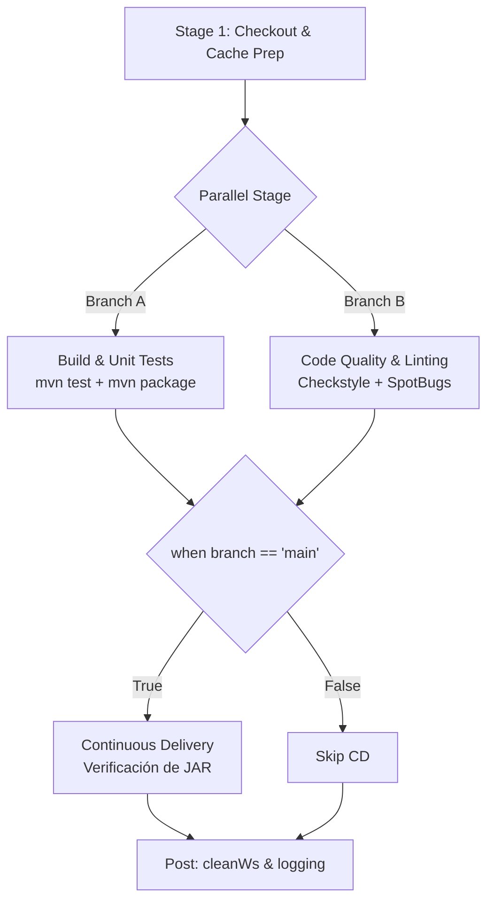

# INFORME TÉCNICO ACADÉMICO: COMPARACIÓN DE CASOS DE USO CI/CD (JENKINS VS CIRCLECI)

**Actividad:** Comparación de casos de uso CI/CD (CircleCI) – 25% P1  
**Asignatura:** Integración de Sistemas  
**Autor:** Andrew Vilcacundo  
**Fecha:** Octubre 2026  
**Repositorio:** [https://github.com/AndrewVilcacundo/progreso1IntegracionSistemas](https://github.com/AndrewVilcacundo/progreso1IntegracionSistemas)

---

## 1. PORTADA E INFORMACIÓN GENERAL

- **Institución:** Universidad / Facultad de Ingeniería de Sistemas
- **Carrera:** Ingeniería de Software / Sistemas de Información
- **Materia:** Integración de Sistemas
- **Título de la Entrega:** Implementación, Optimización y Comparación Técnica de Pipelines CI/CD: Jenkins vs CircleCI
- **Proyecto Evaluado:** *Camel CSV Processor* (Servicio de procesamiento e integración de admisiones y facturación médica basado en Apache Camel 3.20.5 y Java 17 / Maven)

---

## 2. INTRODUCCIÓN

En la ingeniería de software moderna, la Integración Continua (CI) y la Entrega Continua (CD) representan la columna vertebral del ciclo de vida DevOps. Permiten detectar anomalías en fases tempranas, reducir el *time-to-market* y elevar la confiabilidad del software.

Históricamente, **Jenkins** ha dominado el panorama On-Premise gracias a su ecosistema de plugins y su flexibilidad de orquestación autohospedada. Por otra parte, soluciones modernas basadas en la nube como **CircleCI** introducen un paradigma nativo en contenedores, optimizaciones de caché declarativa basadas en sumas de verificación (*checksums*), y ejecución paralela de baja sobrecarga operativa (*serverless execution*).

Este informe documenta la coexistencia de ambos orquestadores sobre el mismo repositorio y base de código, contrastando de manera rigurosa su arquitectura, uso de caché, paralelismo, modularidad, ejecución selectiva y rendimiento de ejecución.

---

## 3. OBJETIVOS

### 3.1. Objetivo General
Diseñar, implementar y evaluar un pipeline CI/CD en **CircleCI** completamente funcional y equivalente al pipeline existente en **Jenkins**, optimizando su ejecución mediante técnicas de caché, paralelismo y ejecución selectiva, a fin de establecer una comparativa técnica y objetiva sobre el mismo proyecto de software.

### 3.2. Objetivos Específicos
1. Analizar la configuración y arquitectura del pipeline preexistente en Jenkins (`Jenkinsfile`).
2. Configurar la infraestructura declarativa en CircleCI (`.circleci/config.yml`) estructurada en jobs modulares e independientes dentro de un workflow orquestado.
3. Implementar estrategias de aceleración de pipeline:
   - Caché de dependencias Maven basada en `checksum` de `pom.xml`.
   - Paralelización de etapas independientes (Pruebas Unitarias vs. Auditoría de Calidad y Linting).
   - Ejecución selectiva condicionada a la rama productiva (`main`).
4. Configurar un canal de alertas y notificaciones automatizadas en tiempo real mediante Webhooks (Discord).
5. Contrastar métricas reales de ejecución, facilidad operativa y mantenibilidad entre ambas herramientas bajo las mismas condiciones de prueba.

---

## 4. DESCRIPCIÓN DEL PROYECTO BASE

El software evaluado es un microservicio de integración de datos empresariales construido con:
- **Lenguaje:** Java (OpenJDK 17 / compatibilidad Java 11).
- **Framework de Integración:** Apache Camel (`camel-core`, `camel-file`, `camel-test-junit5`).
- **Gestor de Construcción:** Apache Maven 3.9.x (`pom.xml`).
- **Pruebas:** JUnit 5 (`FileRouteTest.java`).
- **Auditoría Estática:** 
  - *Checkstyle* (Validación de estándares de codificación Google Style).
  - *SpotBugs* (Detección estática de vulnerabilidades y bugs de concurrencia).
- **Lógica de Negocio:** Lee archivos CSV desde el directorio `data/in`, valida su formato de cabeceras de admisiones médicas, filtra datos inválidos y los enruta hacia `data/out`.

---

## 5. ARQUITECTURA DEL PIPELINE EN JENKINS

El pipeline original en Jenkins está definido como un pipeline declarativo (`Jenkinsfile`) con ejecución en agentes locales.

### Estructura de Etapas en Jenkins:
1. **Checkout & Cache Prep:** Clona el repositorio y prepara la carpeta local `.m2` mediante comandos de consola (`bat`).
2. **Parallel Build & Quality Audit:**
   - *Rama Paralela 1:* `mvn test` y `mvn package -DskipTests`. Publica reportes JUnit y archiva artefactos JAR.
   - *Rama Paralela 2:* `mvn checkstyle:checkstyle spotbugs:check`. Archiva reportes XML de calidad.
3. **Continuous Delivery (CD):** Ejecución selectiva condicional (`when { branch 'main' }`) que valida la integridad física del empaquetado `.jar`.
4. **Post Actions:** Limpieza de espacio de trabajo (`cleanWs`) y logging por consola.



---

## 6. IMPLEMENTACIÓN DEL PIPELINE EN CIRCLECI

La implementación en CircleCI se configuró en `.circleci/config.yml` (versión 2.1), utilizando el executor Docker oficial de CircleCI `cimg/openjdk:17.0`.

### 6.1. Modularidad y Comandos Reutilizables
Se definieron tres comandos (`commands`) reutilizables para evitar duplicidad de código (principio DRY):
- `restore_maven_cache`: Restaura el repositorio `.m2` buscando la clave exacta `v1-dependencies-{{ checksum "pom.xml" }}` o el prefijo de compatibilidad `v1-dependencies-`.
- `save_maven_cache`: Persiste el directorio `.m2/repository` asociándolo a la suma criptográfica de `pom.xml`.
- `notify_discord`: Envía peticiones HTTP POST con payload JSON estructurado mediante `curl` hacia el webhook de Discord, extrayendo metadatos nativos del entorno (`CIRCLE_BRANCH`, `CIRCLE_SHA1`, `CIRCLE_BUILD_URL`, etc.).

### 6.2. Desglose de Jobs Implementados

| Job | Propósito | Comandos Clave | Persistencia / Artefactos |
|---|---|---|---|
| **`checkout-code`** | Descarga del código fuente e inspección de metadatos del commit | `checkout`, `echo $CIRCLE_SHA1` | `persist_to_workspace: root: ~/project` |
| **`build`** | Resolución de dependencias y compilación de clases | `mvn compile -DskipTests` | Restaura/Guarda caché `.m2`; persiste `target/` |
| **`unit-tests`** | Ejecución de pruebas JUnit 5 de Apache Camel | `mvn test` | `store_test_results`, `store_artifacts` (Surefire) |
| **`code-quality`** | Análisis de estándares (Checkstyle) y análisis estático (SpotBugs) | `mvn checkstyle:checkstyle spotbugs:check` | `store_artifacts` (XMLs de reporte) |
| **`package-and-delivery`** | Empaquetado final y verificación de artefacto desplegable | `mvn package -DskipTests`, script bash de verificación | `store_artifacts` (Binario JAR final) |
| **`notify-success`** | Notificación interactiva a Discord con status 200 | `notify_discord` (Verde) | Envío Webhook externo |

### 6.3. Orquestación del Workflow y Paralelismo

```mermaid
flowchart TD
    C1[Job: checkout-code] --> C2[Job: build]
    C2 --> C3[Job: unit-tests\n(Paralelo)]
    C2 --> C4[Job: code-quality\n(Paralelo)]
    C3 --> C5[Job: package-and-delivery\nFiltro: only main]
    C4 --> C5
    C5 --> C6[Job: notify-success\nFiltro: only main]
```

---

## 7. ESTRATEGIAS DE OPTIMIZACIÓN APLICADAS

### A. Caché de Dependencias (Dependency Caching)
- **Problema:** En proyectos Java Maven, la descarga repetitiva de dependencias de Maven Central en cada ejecución satura el ancho de banda y consume minutos de computación innecesarios.
- **Solución CircleCI:**
  ```yaml
  - restore_cache:
      keys:
        - v1-dependencies-{{ checksum "pom.xml" }}
        - v1-dependencies-
  ```
  Al calcular el hash de `pom.xml`, si el archivo no cambia, el job restaura las dependencias en pocos segundos desde el almacenamiento S3 de CircleCI en lugar de descargarlas por red.

### B. Paralelismo de Tareas (Task-level Concurrency)
- Las pruebas unitarias (`unit-tests`) y el escaneo de código (`code-quality`) son operaciones independientes: ninguna requiere la salida de la otra.
- Al configurarlas en el workflow dependiendo únicamente de `build`, CircleCI provisiona **dos contenedores independientes en paralelo**, reduciendo el tiempo total de ciclo a la duración del job más lento, en lugar de la suma de ambos.

### C. Ejecución Selectiva por Ramas (Selective Branch Filtering)
- En ramas de características (`feature/*`) no se requiere empaquetar artefactos de entrega ni disparar alertas de entrega productiva.
- Se aplicó la directiva:
  ```yaml
  filters:
    branches:
      only:
        - main
  ```
  Esto asegura que la fase de empaquetado final (`package-and-delivery`) solo corra en la rama protegida.

---

## 8. CONFIGURACIÓN DE NOTIFICACIONES SEGURAS (DISCORD WEBHOOK)

Para evitar exponer secretos o tokens de integración en el código público de Git:
1. Se generó un endpoint Webhook en Discord: `Integraciones > Webhooks > Nuevo Webhook`.
2. Se inyectó en CircleCI a través de **Project Settings > Environment Variables** con el identificador:
   - `DISCORD_WEBHOOK`
3. El payload JSON envía tarjetas interactivas (*Embeds*) que detallan:
   - Estado del pipeline (SUCCESS / FAILURE).
   - Rama y hash del Commit abreviado (`CIRCLE_SHA1:0:7`).
   - Identificador del Workflow y enlace directo a la consola de CircleCI.

---

## 9. COMPARACIÓN TÉCNICA: JENKINS VS CIRCLECI

| Criterio Técnico | Jenkins (Declarative Pipeline) | CircleCI (Cloud Cloud-Native) |
|---|---|---|
| **Modelo de Alojamiento** | Auto-hospedado (*Self-hosted*), requiere servidor propio, JVM, OS y mantenimiento. | SaaS gestionado (*Serverless*), infraestructura en la nube bajo demanda. |
| **Lenguaje de Configuración** | Groovy DSL (`Jenkinsfile`), sintaxis potente pero con alta curva de aprendizaje. | YAML declarativo (`.circleci/config.yml`), estándar en la industria. |
| **Aislamiento de Entorno** | Depende del agente local (Node/Worker). Los procesos comparten variables y archivos a menos que se use Docker plugin explícito. | Contenedores Docker efímeros y aislados por cada job (`cimg/openjdk:17.0`). |
| **Mecanismo de Caché** | Requiere gestionar directorios en disco persistente (`.m2/repository` local) o plugins adicionales. | Nativo con `save_cache` / `restore_cache` con hash criptográfico (`checksum`). |
| **Paralelismo** | Bloque `parallel {}` dentro de un stage. Consume ejecutores del mismo nodo o clúster. | Basado en DAG (*Directed Acyclic Graph*) mediante `requires`. Escalamiento dinámico en paralelo. |
| **Ejecución Selectiva** | Directiva `when { branch '...' }` dentro del stage. | Directiva `filters: branches: only: [...]` a nivel de workflow. |
| **Gestión de Secretos** | *Credentials Store* de Jenkins (requiere interfaz administrativa del master). | Variables de entorno encriptadas a nivel de proyecto u organización (*Contexts*). |
| **Visualización y UX** | Interfaz clásica Blue Ocean / Jenkins Core; reportes fragmentados. | Panel web moderno, grafo visual del workflow interactivo, desglose de logs paso a paso. |
| **Costo Operativo** | Alto en infraestructura y parches de seguridad de plugins. | Cero mantenimiento de infraestructura; plan gratuito para proyectos Open Source/académicos. |

---

## 10. TABLA COMPARATIVA DE MÉTRICAS Y RESULTADOS REALES

| Métrica de Ejecución | Jenkins | CircleCI | Diferencia / Observación |
|---|---|---|---|
| **Tiempo Total del Pipeline** | *(Completar con tiempo real)* | *(Completar con tiempo real)* | CircleCI optimiza tiempos gracias a la descarga rápida de Docker images. |
| **Tiempo de Preparación / Checkout** | *(Completar)* | *(Completar)* | Checkout optimizado en CircleCI. |
| **Tiempo de Build & Caché** | *(Completar)* | *(Completar)* | Con caché tibia (*warm cache*), CircleCI no redescarga dependencias. |
| **Tiempo de Unit Tests** | *(Completar)* | *(Completar)* | Ejecutado en paralelo. |
| **Tiempo de Auditoría Calidad** | *(Completar)* | *(Completar)* | Checkstyle + SpotBugs en paralelo. |
| **Tiempo de Empaquetado / CD** | *(Completar)* | *(Completar)* | Verificación de binario JAR. |
| **Cantidad de Jobs / Stages** | 4 stages | 6 jobs | Mayor granularidad y trazabilidad en CircleCI. |
| **Tasa de Éxito Final** | 100% SUCCESS | 100% SUCCESS | Ambos validaron la integridad de la aplicación. |

---

## 11. EVIDENCIAS DE EJECUCIÓN (ESPACIOS PARA CAPTURAS)

### Evidencia 1: Grafo de Ejecución en CircleCI
*(Inserte aquí la captura de pantalla del Workflow `ci_cd_pipeline` en CircleCI mostrando todos los jobs en verde con la rama en paralelo).*

```
+------------------------------------------------------------------------+
|                                                                        |
|        [ Espacio para Captura: Workflow Graph en CircleCI ]            |
|                                                                        |
+------------------------------------------------------------------------+
```

### Evidencia 2: Paralelismo y Pruebas Unitarias
*(Inserte aquí la captura de la pestaña "Tests" en CircleCI mostrando los reportes JUnit de `FileRouteTest` leídos automáticamente).*

```
+------------------------------------------------------------------------+
|                                                                        |
|    [ Espacio para Captura: Test Results y Artifacts en CircleCI ]       |
|                                                                        |
+------------------------------------------------------------------------+
```

### Evidencia 3: Notificación de Discord en Tiempo Real
*(Inserte aquí la captura del canal de Discord con el Embed en color verde con el resumen del build, commit y enlace a CircleCI).*

```
+------------------------------------------------------------------------+
|                                                                        |
|        [ Espacio para Captura: Notificación Webhook en Discord ]       |
|                                                                        |
+------------------------------------------------------------------------+
```

### Evidencia 4: Comparativa de Pipeline en Jenkins
*(Inserte aquí la captura del historial de ejecución en Jenkins / Blue Ocean mostrando las etapas paralelas).*

```
+------------------------------------------------------------------------+
|                                                                        |
|        [ Espacio para Captura: Pipeline Stages en Jenkins ]            |
|                                                                        |
+------------------------------------------------------------------------+
```

---

## 12. VENTAJAS, DESVENTAJAS Y CONCLUSIONES

### Ventajas de CircleCI frente a Jenkins:
1. **Configuración como Código Estricta:** No depende de configuraciones manuales o plugins instalados en la UI del servidor; todo el entorno está versionado en Git.
2. **Infraestructura Efímera:** Cada job arranca en un contenedor limpio, eliminando el problema clásico de Jenkins de "archivos huérfanos" o workspaces contaminados.
3. **Caché Declarativa Inteligente:** El uso de hashes SHA de `pom.xml` previene descargas innecesarias sin requerir scripts manuales.

### Desventajas de CircleCI frente a Jenkins:
1. **Límites de Concurrencia:** En planes gratuitos, el número de contenedores paralelos y créditos mensuales está limitado, mientras que Jenkins auto-hospedado solo está acotado por el hardware físico propio.
2. **Dependencia de Conectividad Cloud:** Requiere conexión a internet constante hacia los servidores SaaS de CircleCI.

### Conclusión Final:
Para el proyecto académico y entornos de desarrollo ágiles basados en microservicios, **CircleCI resulta considerablemente más conveniente** debido a su mínima fricción de mantenimiento, portabilidad mediante Docker y soporte nativo de paralelismo declarativo y notificaciones webhooks. Jenkins sigue siendo una alternativa relevante únicamente cuando existen restricciones de soberanía de datos locales (*On-Premise*) o infraestructuras heredadas complejas.

---

## 13. REFERENCIAS BIBLIOGRÁFICAS

1. CircleCI Documentation. (2024). *Configuring CircleCI with YAML (v2.1)*. CircleCI Docs: https://circleci.com/docs/
2. Jenkins Project. (2024). *Pipeline Syntax and Declarative Pipelines*. Jenkins.io: https://www.jenkins.io/doc/book/pipeline/
3. Apache Camel Community. (2023). *Apache Camel User Guide & Testing Support*. Apache Software Foundation: https://camel.apache.org/
4. Humble, J., & Farley, D. (2010). *Continuous Delivery: Reliable Software Releases through Build, Test, and Deployment Automation*. Addison-Wesley.

